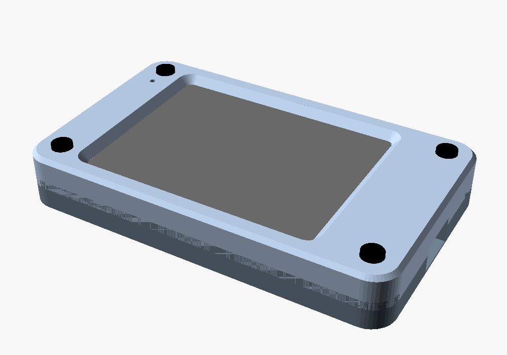
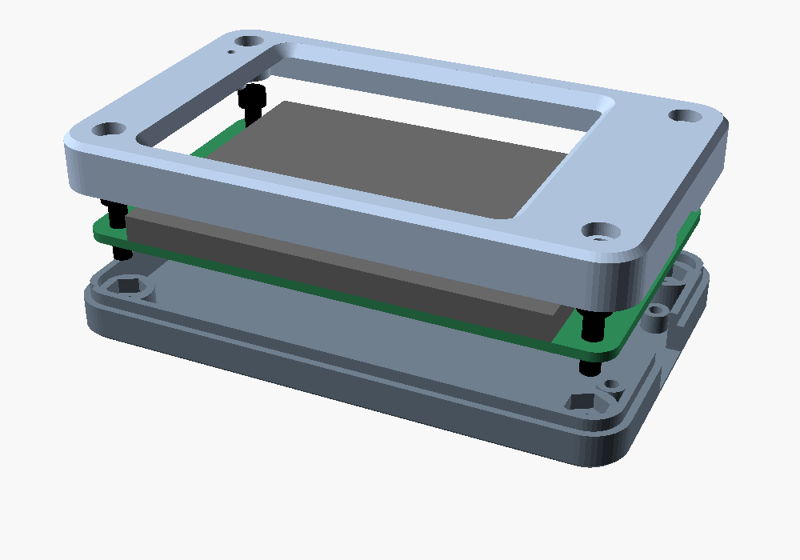
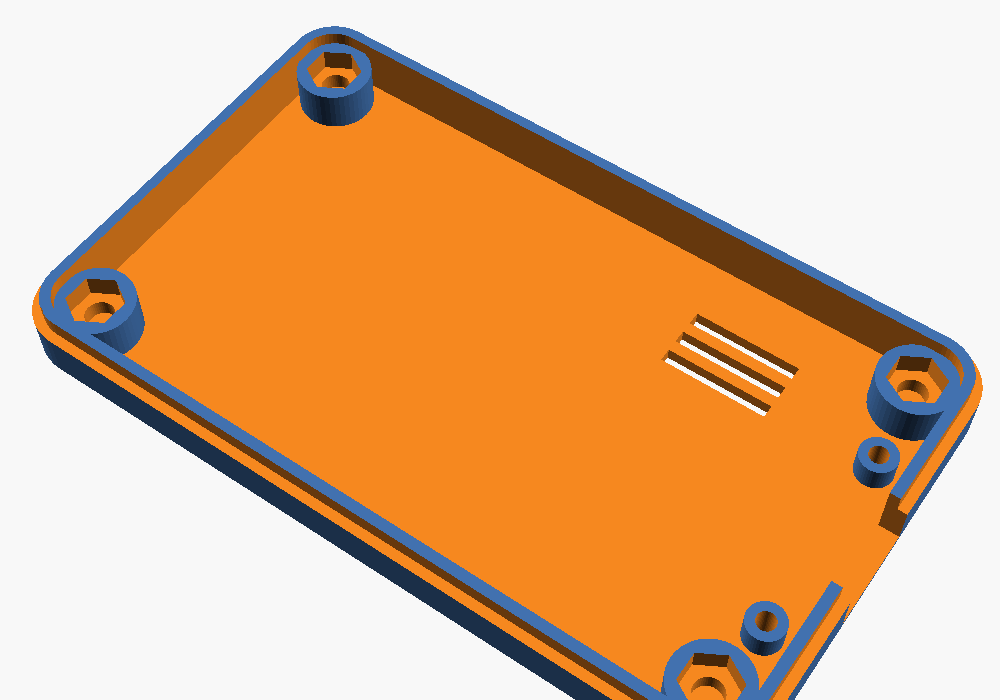
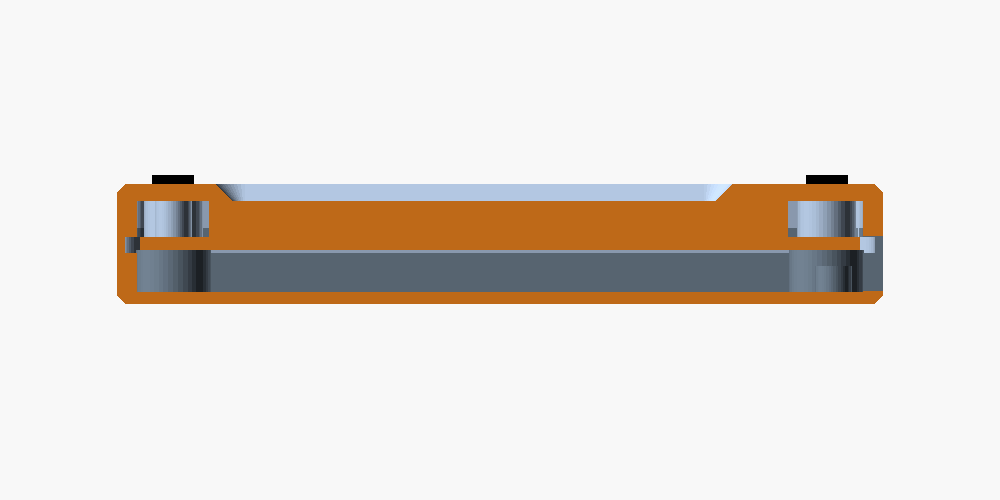

# Case for the ES3C28P (thin, just the board)

A thin 3D-printable case for the 2.8" LCDWIKI **ES3C28P** ESP32-S3 touch display module, designed in
OpenSCAD. It holds only the board, powered over USB-C: no battery, no speaker, no switch. It fits either
firmware variant ([`es3c28p-320x240`](../firmware/es3c28p-320x240) or
[`es3c28p-wifi-320x240`](../firmware/es3c28p-wifi-320x240)).

**Status: designed and checked on screen, never printed.** Print the fit-test frame first.



## What it is

Two printed parts held together by four M3 screws, about **91.4 x 55.4 x 14.4 mm** (the screw heads add 1 mm).
The earlier battery version was 28.4 mm thick.

Front to back: 2 mm shell with a bevelled screen opening, screen, board, a 5 mm cavity, 1.5 mm floor.



- **Top half** holds the screen and the board. The opening has a 2 mm Game Boy style bevel, wider at the
  outer surface and narrowing to the glass, where it covers the bezel (opening = active area + 0.1 mm per
  side). It is 45 degrees, so it prints face-down without supports. Four screw recesses are 0.25 mm wider
  than the heads, 2 mm deep, so 1 mm of each head stands proud. A 1.5 mm hole above the microphone.
- **Bottom half** has four full-height posts that the board rests on. Each screw lands in a hexagonal nut
  pocket that opens upward: drop an M3 nut in, add a dab of glue, then fit the board.
- **USB-C** cutout at the +X end, 12 x 6.6 mm, large enough for a plug with an overmould.
- **BOOT and RESET** are reachable from the back: a 2.2 mm hole through the floor and a guide tube that
  carries a paperclip or SIM pin to each button. The tube stops 0.4 mm short of the button.
- **Cooling:** three slots in the floor under the ESP32 module, the warmest part.
- **Joint:** the top half has a 1 mm skirt that laps over a step in the bottom half's wall.





## Why 5 mm behind the board

The tallest parts on the back of the board are connectors, 4.7 mm high (UART, IO, I2C, SPEAKER, the
battery connector and the SD slot). The cavity is 5.0 mm so nothing touches the floor. The case cannot be
thinner than that without cutting windows in the floor for the connectors, which would then stand out of the
back. I can add that if you want it; it saves about 3 mm.

## Parts you need

| Part | Notes |
|---|---|
| 4 x M3 x 10 mm screws, black, 5 mm head, 3 mm thick | head seat to the bottom of the nut is 8.5 mm; the 10 mm screw ends in a 2 mm blind hole below the nut |
| 4 x M3 nuts | 5.5 mm across flats, 2.4 mm thick |
| USB-C cable | the plug overmould must fit 12 x 6.6 mm; `usb_cut_w` / `usb_cut_h` change it |

## Printing

Files are already turned the right way up:

- `case_top_print.stl`: face-down, the outer surface on the bed. No supports.
- `case_bottom_print.stl`: floor on the bed.

Suggested: 0.2 mm layers, 3 perimeters, 15-20% infill, no supports. Both halves are solid manifolds in
OpenSCAD. The only long bridge is the 12 mm USB-C cutout.

## Changing the design

Open `case.scad` in [OpenSCAD](https://openscad.org) (Windows, macOS and Linux builds exist; 2021.01 or
newer). Every dimension is a named variable at the top. Set `part`, press F5 to preview, F6 to render, then
File > Export > STL.

| `part` | Shows |
|---|---|
| `assembled`, `exploded` | everything, with board, screen and screws as ghosts |
| `top`, `bottom` | one half in design orientation |
| `top_print`, `bottom_print` | one half in print orientation, for export |

Set `section = true` and `cut_y` to cut the assembled view open.

`check.scad` runs 13 checks: glass, board and screws against both halves, the tallest back-of-board parts
against both halves, a USB-C plug against both halves, the two halves against each other, and a 1.6 mm pin
pushed through each BOOT/RESET hole. All pass. The checker has positive controls: shifting the pin 3 mm,
making the board parts 2 mm taller, and checking that the pin actually reaches the buttons all behave as
expected. The first run of the pin check failed and found a real bug (the pin hole stopped short of the guide
tube), which is fixed.

```bash
openscad -D 'check="keepout_bottom"' -D 'part="none"' -o /tmp/x.stl check.scad
# "Current top level object is empty" means no overlap, which is the wanted result
# (pin_reaches is the opposite: it must NOT be empty)
```

## What to verify before printing

1. **Fit-test frame** (`fit_test.scad`): print it and check the board drops in. Adjust `fit_clearance`.
2. **Back of the board:** component positions are read from the vendor drawing and are approximate. Check
   the BOOT and RESET positions (`btn_x`, `btn_y`) and the USB-C position (assumed flush with the board
   edge) on the real board.
3. **Screws:** confirm head size and the 10 mm length against what you have.

## Left out, and why

- **Battery, speaker, power switch:** removed on purpose; the board runs from USB. The battery indicator
  in the WiFi firmware hides itself when no battery is connected.
- **SD card opening:** you said it is not needed. The slot is inside the case.
- **UART, IO, I2C connector access:** not needed for this use; they are inside the case.

## Other files

`fit_test.scad`, `fit_test.stl`, `fit_test.png`: the thin fit-test frame (board pocket and the four
holes). Print flat, no supports.
